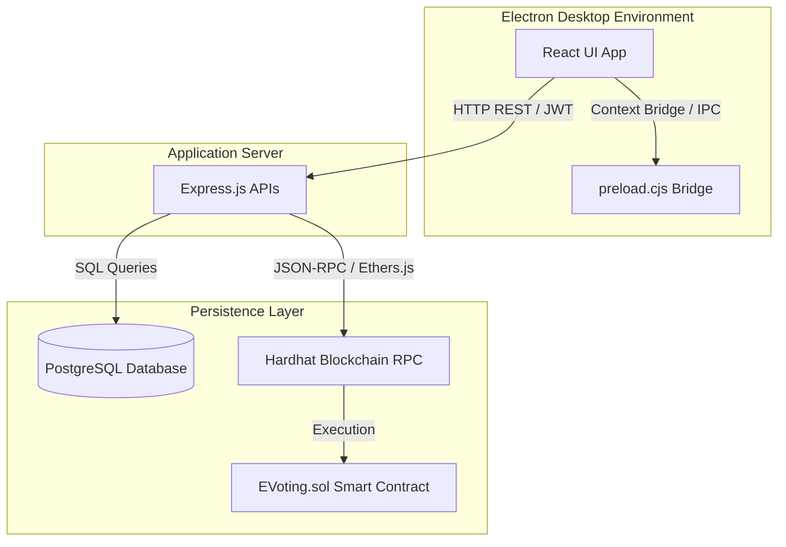

# System Architecture

The **Secure E-Voting System** is structured as a multi-tier decentralized desktop application.

## 1. Modular Components

### Client Layer (Vite + React)
* Renders the administrative console and voter dashboards.
* Automatically queries system status signals from the Express API to toggle interface buttons.
* Interfaces with MetaMask to sign blockchain voting transactions using the browser wallet provider.

### Desktop Wrapper Shell (Electron)
* Wraps the web application in a standalone desktop layout container.
* Exposes safe diagnostic methods via `contextBridge` in `preload.cjs` to retrieve desktop build details (OS version, Packaging state).
* Configured with secure window settings: `contextIsolation: true` and `nodeIntegration: false`.

### Application API Layer (Express.js)
* Serves as the central security sentinel.
* Validates inputs, decodes token parameters, enforces user-role permissions, and logs system telemetry records to the database.
* Coordinates transaction synchronization by mapping database schema entries to blockchain blocks.

### Database Layer (PostgreSQL)
* Retains voter identity, draft election metadata, audit event lists, and blockchain transaction heights.

### Smart Contract Layer (Solidity + Hardhat)
* Serves as the ultimate source of truth for voting tallies, authorizations, and election status transitions.
